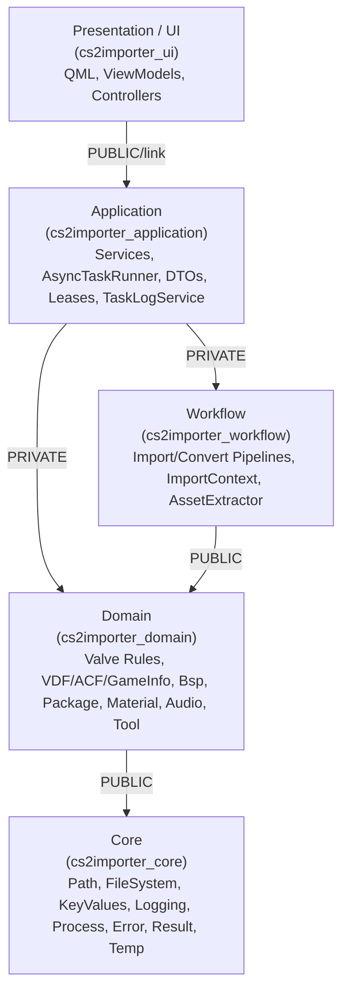

# CS2 Map Importer — 架构参考 (Single Source of Truth)

本文档是 `cs2-map-importer` 的架构单一事实源（Disclosed Reference），定义五层垂直架构、CMake 物理隔离、**Deep Module（深模块）**原则、**Single-Point Defense（单点契约防御）**规则与跨层数据流。

---

## 1. 五层垂直架构与 CMake 物理隔离



### 1.1 CMake 编译期物理隔离

目录名本身不构成架构边界，真正的边界由 CMake 目标链接与可见性强制执行：

| CMake 目标 | 项目层链接 | 可见性约束与隔离效果 |
| :--- | :--- | :--- |
| `cs2importer_core` | 无 | 通用基础设施，零 Valve / UI / Application 依赖，可独立复用。 |
| `cs2importer_domain` | `PUBLIC cs2importer_core` | 独占 Valve/Source 1 & 2 领域规则（含原生 C++20 VPK/BSP 解包与反编译/VTF/LZMA1 解析）；底层辅助依赖（如 `Qt6::ZlibPrivate`）由消费层 `PRIVATE` 链接，公共头文件不暴露内部实现类型。 |
| `cs2importer_workflow` | `PUBLIC cs2importer_domain` | 编排多步骤导入/转换流水线，不感知 Application 或 UI。 |
| `cs2importer_application` | `PRIVATE cs2importer_workflow`<br/>`PRIVATE cs2importer_domain`<br/>`PUBLIC cs2importer_core` | **`Workflow` 与 `Domain` 均为 `PRIVATE` 链接**，编译期物理阻断 `UI` 传递包含或调用 `Domain`/`Workflow` 头文件。Application 面向 UI 的头文件通过前置声明（如 `VpkIndex`、`ImportContext`）隔离底层类型。 |
| `cs2importer_ui` | `cs2importer_application` + Qt/QML | 仅消费 Application 门面与 DTO，不直接链接 `Domain`/`Workflow`/`Core`（也不 include `Core/Logging/*`）。 |
| `cs2importer` (主程序) | 组合根 (`src/Main.cpp`) + QML + `qt_add_translations` | 唯一装配所有服务与共享实例（如共享 `VpkSignatureLeaseService`）的组合根。 |

> Qt 模块（如 `Qt6::Core`、`Qt6::Gui`）与 `third_party/` 库不属于项目分层，由实际消费的最底层按需链接。`src/Legacy/` 未接入默认构建，仅作迁移参照。

### 1.2 各层职责归属

* **Presentation / UI (`src/UI/`, `src/qml/`)**：暴露 `Q_PROPERTY` 与槽函数；将用户输入转发至 Application 请求 DTO；订阅 Application 信号并渲染结果与错误。
* **Application (`src/Application/`)**：面向 UI 的门面与 DTO 转换；通过 `AsyncTaskRunner` 调度异步任务；管理共享所有权服务（PassKey + `create()` 工厂 + `weak_from_this().lock()` + RAII 状态回滚 + 主线程亲和性信号分发）；宿主环境探测（Windows 注册表 / Steam 根目录）、文件租约（`VpkSignatureLeaseService`）、按游戏目录分类的单包 SHA-256 粒度 VPK 索引缓存（`VpkIndexService`，内置游戏归一回 `GameDefinition::id`、`custom` 自动附带 `gameinfo` 游戏名如 `custom_<game_slug>`，持久化至 `<AppDir>/data/indices/<category>/<sha256>.vpkidx` 并做单飞去重）与日志投递门面（`TaskLogService`）。
* **Workflow (`src/Workflow/`)**：具体导入/转换用例的多步骤流水线（`ParticleImportWorkflow`、`SoundscapeConvertWorkflow`、`AssetExtractor`、`AssetLocator`、`BspDecompileWorkflow`、`BspEmbeddedExtractor`、`VtfExtractor`）；经 `ImportContext` 协调取消、日志与步骤进度（步骤成功后延后推进）；管理暂存隔离与失败/取消时的半成品清理。
* **Domain (`src/Domain/`)**：确定性 Valve/Source 业务规则与格式解析——`Game`（`SteamGameLocator` 负责 VDF/ACF 解析、`GameInstallationResolver`、`GameInfoParser`、`SearchPathResolver`、`GameValidator`）、`Asset`（`AssetLocateStrategy` 基于已校验索引执行零开包定位，仅对未入索引的回退 VPK 开包探测，直接返回 `Core::Result<AssetLocateOutcome>`）、`Bsp`（`BspDecompiler`、`BspDecompileConfig` 提供进程内原生 C++20 Source 1 BSP 反编译至 VMF）、`Package`（`PackArchive`、`PackArchivePool`、`VpkArchiveIndex`、`VpkIndex`、`VpkIndexBuilder`、`BspPackExtractor`）、`Material`（`VtfCodec`/`VtfConverter`/`TextureIO`/`TextureProcess`/`SkyboxCubeBuilder`）、`Audio`（Soundscape 解析与 KV3 写入）、`Tool`（官方 CLI 工具强类型封装与日志解析器）。
* **Core (`src/Core/`)**：通用基础设施——`Path`（Tier 1/Tier 2 路径安全）、`FileSystem`（`FileSystem`、`AtomicFile`、`FileLease`）、`KeyValues`（UTF-8 流式拉取/推送读写、方言预设与局部 `KeyValuesNode` 子树）、`Process`（`ProcessRunner`）、`Logging`（`LogManager`、`TaskLoggingContext`）、`Async`（`CancellationToken`）、`Error`（`ExecutionGuard`、`Error`、`Exception`）、`Result<T>`、`Hash`（`Sha256`）、`Temp`（`TempFile`、`TempDirectory`）。

---

## 2. Deep Module（深模块）与删除测试（Deletion Test）

设计或评审任意类、服务或接口时，优先构建**深模块（Deep Module）**：**窄而稳定的公开接口，隐藏厚重、高内聚的实现**。

### 删除测试（Deletion Test）

在保留或新增包装类、中间模型或虚接口前，执行删除测试：

> **“如果删除该类并让调用方直接对接下层模块，是否会丢失真正的不变式、策略抽象或架构边界？”**

如果答案是否定的，直接删除该浅层包装：

* **拒绝传声筒包装（Shallow Pass-Through）**：如仅做字段镜像的中间 DTO（`Domain` ↔ 冗余中间 struct ↔ `Application` DTO）、单行 `using` 伪装头文件、逐行转发下层方法的校验器壳。
* **拒绝假想接缝（Speculative Interface）**：只有一个实现类且无真实多态替换需求的纯虚接口与适配器，直接由策略类调用具体组件。
* **职责归位铁律**：
  * **多步导入/转换流水线归 `Workflow`**（如 `SoundscapeConvertWorkflow`、`ParticleImportWorkflow`），`Application` 仅保留轻量门面与异步调度；
  * **Valve 格式与 VDF/ACF/GameInfo 解析归 `Domain`**（`SteamGameLocator`、`GameInstallationResolver`、`GameInfoParser`），`Application` 不直接操纵 `Core::KeyValues` 解析 Valve 配置；
  * **宿主环境探测、共享租约、异步调度与 UI DTO 转换归 `Application`**。

---

## 3. Single-Point Defense（单点契约防御）

每个安全与正确性不变式只在调用链的**权威边界防御一次**；上游与中间层直接透传参数或 `Core::Result<T>`，避免跨层重复防御造成的维护噪音与语义漂移。

| 防御维度 | 权威责任边界（唯一防御点） | 机制与契约 | 上游 / 中间层职责 |
| :--- | :--- | :--- | :--- |
| **异常屏障**<br/>(`Core::Error::ExecutionGuard`) | 1. 异步任务调度顶层：`AsyncTaskRunner`<br/>2. 对外暴露的同步顶层入口<br/>3. 会抛异常的底层/第三方库调用点：`Core::FileSystem`、抛异常 STL / 外部解析调用 | 将 `Core::Error::Exception`、`std::exception` 与未知异常统一转译为单层 `Core::Result<T>::failure`，并附加 `ExecutionContext`；Core 层零领域关键词猜词。 | 项目内部 `Result<T>` 纯函数之间直接返回与透传 `Result<T>`，**不层层嵌套 `ExecutionGuard::guard`**，也不编写自定义 `runGuarded` 模板。 |
| **路径安全**<br/>(Tier 1 + Tier 2) | **Tier 1 逻辑边界**：调用方使用 `baseDir.resolveBelow(relPath)` 组合相对路径（`weakly_canonical`，拦截 `..`、盘符冒号与 NTFS ADS 流）。<br/>**Tier 2 物理内核句柄边界**：底层写入/提取原语（`AtomicFile::writeAtomic`、`FileSystem::copy/move`、`PackArchive::extractEntryToFile`、`BspPackExtractor`）接收 `expectedBaseDir`，打开文件句柄后执行 `verifyFileWithinBase`（Win32 `GetFinalPathNameByHandleW`）根除 TOCTOU 与 Junction 逃逸。 | 越界时底层原语立即安全清除残存文件并返回/抛出 `ErrorCode::InvalidPath`。 | 中间层（`Workflow` / `Application` / `VtfConverter`）透传 `expectedBaseDir` 给底层原语，**不在调用前重复手写 `isSubpathOf`**。 |
| **前置校验**<br/>(`isEmpty` / `isValid` / `exists` / `isCancelled`) | 实际消费该参数的最低层（通常是 `Domain` 函数或持有该资源的 `Workflow` 步骤）。 | 返回携带结构化 `ErrorCode` 与诊断信息的 `Core::Result<T>`。 | 上层直接透传下层返回的 `Core::Result<T>`，**不复制粘贴相同的 `if` 前置校验块**。 |

---

## 4. 跨层数据流与集成契约

### 4.1 UI ↔ Application DTO 数据流

```text
QML / UI 字符串与原始 URL (含 file://)
   ↓
Application 请求 DTO (如 ParticleImportRequest)
   ↓  GameEnvironmentService::cleanPath 清洗路径；推导领域标志（如 isCsgo）
Application 解析为 GameType / FilesystemPath，注入共享租约与 VpkIndex
   ↓
Workflow 流水线 → Domain 规则/工具 → Core 原语
   ↓
Core::Result<T> → Application 结果 DTO (如 ParticleImportResult)
   ↓  主线程亲和性投递 (QueuedConnection)
UI Q_PROPERTY / 信号展示
```

### 4.2 日志数据流 (`TaskLogService`)

```text
Core::Logging::LogManager (TaskLoggingContext 8KB/50ms/Error 自动刷盘 + TaskFileSink::flushTask 单文件刷盘)
   ↓  私有 SinkBridge (接入创建/日志块/进度/终态 4 类事件，按 taskId 合批 + 双阶段 detach() 防 UAF)
Application::Logging::TaskLogService (UI 线程 33ms 帧合批，首帧/创建/终态直通 + 单锁 taskInfo 快照)
   ↓  taskUpdatesReceived(subscriptionId, QVector<TaskLogUpdate>)
UI::ViewModels::LogViewModel (直继承 QAbstractListModel，驱动 LogMessageListModel[deque/5000行上限] 与 toolTaskUpdated 事件推送)
```

UI 仅通过 `TaskLogService` 与 `TaskLogDTOs` 消费日志，无任何 `Core/Logging/*` 头文件依赖；`ToolLogWindow` 通过 `LogViewModel::toolTaskUpdated` 事件驱动刷新（零轮询）。

### 4.3 外部工具子任务流 (`TaskLoggingContext::createToolSubTask`)

`Domain::Tool`（`ResourceCompilerTool`、`Source1ImportTool`）不直接依赖 `LogManager::instance()`，而是通过工作流传入的 `TaskLoggingContext*` 派生隐藏工具子任务：

```text
Workflow::Common::ImportContext (持有父阶段 TaskLoggingContext*)
   ↓  传入 taskCtx*
Domain::Tool (ResourceCompilerTool / Source1ImportTool)
   ├── taskCtx->createToolSubTask(fullCommandLine, assetBaseName)  // 父任务记录 [EXEC]，工具日志独立落盘
   ├── Core::Process::ProcessRunner::run(...)                      // onStdOutLine/onStdErrLine -> logExternalToolOutput
   └── childTask->finishToolSubTask / failToolSubTask / cancelToolSubTask
```

多文件批量编译（>1 个输入文件）时，工具封装自适应使用 `Core::Temp::TempFile` 生成 `-filelist` 清单，规避 Windows 命令行长度限制。

### 4.4 资产定位、共享池与租约协同流

* **共享租约**：组合根 `src/Main.cpp` 创建单一 `std::shared_ptr<VpkSignatureLeaseService>`，同时注入 `GameEnvironmentService` 与 `ImportPrerequisiteService`，保证 UI 状态监控与导入前置独占锁定共享同一租约。
* **单包 SHA-256 内容寻址缓存与索引透传**：`VpkIndexService` 经 `GameInstallationResolver::resolveIndexCategory` 按游戏分类（已知游戏用短标识 `cs2`/`csgo`/`css` 等，Custom 模组自动拼接清洗后的 `gameinfo` 游戏名如 `custom_<game_slug>`）并基于单个 VPK 的严格 SHA-256 持久化不可变快照 `VpkArchiveIndex`（`<AppDir>/data/indices/<category>/<sha256>.vpkidx`，经 `AtomicFile` 原子落盘并校对头哈希）；命中内存或 `.vpkidx` 磁盘缓存时绝对跳过 `PackArchive::open`，仅对未命中或损坏的新包解析重建，并经 `VpkIndex::compose` 按优先级合并生成 `VpkIndex`（同步维护 `coversVpk` 覆盖集）。`ImportPrerequisiteService::prepare` 同步确保 `vpkIndex` 与 `cs2Index` 就绪，经服务层（如 `ParticleImportService::toWorkflowOptions`）完整透传至工作流选项。
* **零开包定位与按需单次读取**：`AssetExtractor::extract` 在未传入外部 `PackArchivePool` 时在当前调用栈创建单一 `localPool` 供 `AssetLocator::locate` 与 `extractLocated` 共享，遵循 `CS2 Native → Loose File → 优先级感知 VPK 查找` 顺序：`AssetLocateStrategy` 先 O(1) 查询 `VpkIndex::findVpkForEntry`，遍历搜索目标时对 `VpkIndex::coversVpk` 覆盖的 VPK 全程零开包直接定位或跳过（仅对未入索引的额外 VPK 回退 `PackArchivePool` 探测），仅在 `AssetExtractor::extractLocated` 真正提取字节时才打开命中的那 1 个 VPK；`PackArchive::extractEntryToFile` 直接调用 `readEntry`（缺省即返回 `EntryNotFound`），消除多余 `hasEntry` 查找。
